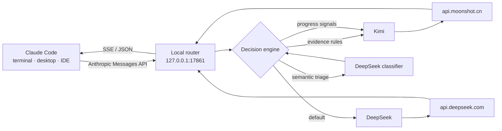

# Claude Model Router

**English** | [简体中文](README.zh-CN.md)

[](https://github.com/dragonxia-ctrl/claude-model-router/actions/workflows/ci.yml)
[](https://nodejs.org/)
[](LICENSE)

A local, safety-first routing proxy for **Claude Code**. It keeps DeepSeek as the default model and escalates to Kimi only when public benchmark evidence or live task signals show a clear Kimi advantage.

> **Status:** early public release. Currently supports **DeepSeek and Kimi only**.
>
> This is an independent community project. It is not affiliated with or endorsed by Anthropic, DeepSeek, or Moonshot AI. Claude Code is a product of Anthropic.

**Version information:** [VERSIONS.md](VERSIONS.md) — what each version changed, why, and the measurements behind it. Current release: **v2 (1.2.0)**.

---

## Why this exists

Claude Code supports one model setting per session. That is simple, but it is a poor fit for mixed workloads:

- Most coding, refactoring, Kaggle, data-science, finance, and legal work does **not** need the most expensive model.
- Long-horizon terminal work, difficult source-verification research, frontier mathematics, complex visual reasoning, and video tasks can benefit from a stronger model.
- Switching models by hand breaks flow and is easy to forget.

This project puts a small HTTP proxy on `127.0.0.1` between Claude Code and the providers. Claude Code sees one local endpoint. The proxy chooses DeepSeek or Kimi for each request, streams the response back, and preserves provider-compatible conversation state.

**Guiding rule:** use Kimi only for demonstrated advantage categories. Everything else stays on DeepSeek.

---

## What it does

- Routes Claude Code's Anthropic-compatible Messages API traffic to DeepSeek or Kimi.
- Defaults to **DeepSeek** for ordinary coding, architecture, refactoring, bug fixing, Kaggle, data science, finance, legal work, and general questions—even when the task is large or difficult.
- Escalates to **Kimi** for:
  - actual video media blocks,
  - genuine long-horizon autonomous project delivery,
  - difficult multi-step tool-assisted research that verifies sources,
  - research-level mathematics and proofs,
  - complex visual reasoning.
  Text heuristics and semantic triage apply only to interactive streaming requests; non-streaming auxiliary calls keep the default provider.
- Escalates based on **progress signals**, not raw tool-call counts:
  - repeated failed verification cycles after edits,
  - repeated error signatures,
  - consecutive tool failures,
  - long mutating sequences (real writes; read-only commands do not count),
  - the same mutating invocation repeated.
- Optionally runs a cheap semantic triage call for long, unclassified tasks. The triage call has thinking disabled, returns a small JSON object, is cached, and safely falls back to DeepSeek on any failure.
- Keeps the same provider for the same task once Kimi has been selected, reducing mid-task model churn.
- Removes incompatible thinking blocks when switching providers.
- Supports explicit forcing with a model alias or `[kimi]` / `[deepseek]` in the prompt.

**Not supported yet:** OpenAI, Gemini, Groq, local models, or any provider other than DeepSeek and Kimi. Adding a provider is a design change, not a configuration tweak; see [CONTRIBUTING.md](CONTRIBUTING.md).

---

## Architecture



### Components

| Path | Responsibility |
| --- | --- |
| `src/router.mjs` | HTTP server, config loading, signals, graceful shutdown |
| `src/handler.mjs` | Auth, endpoint routing, preview endpoint, provider forwarding |
| `src/classifier.mjs` | Explicit overrides, benchmark-advantage rules, progress rules |
| `src/task-text.mjs` | Task extraction and follow-up inheritance |
| `src/progress.mjs` | Read-only vs mutating tool analysis, failed verification detection, repeated errors |
| `src/decision-engine.mjs` | Bounded Kimi residency, recovery probes, semantic-triage cache |
| `src/deescalation.mjs` | Clean-window gates and capped exponential probe backoff |
| `src/semantic.mjs` | One low-cost DeepSeek classification call with thinking disabled |
| `src/sanitize.mjs` | Cross-provider thinking/redacted-thinking cleanup |
| `src/upstream.mjs` | Streaming passthrough, auth headers, cancellation |
| `src/config-store.mjs` | Validation and atomic SIGHUP reload |
| `scripts/lib/install-core.mjs` | Safe installer, dry-run, backup, rollback, Docker operations |
| `bin/claude-router.mjs` | User-facing command line |

### Request lifecycle

1. Claude Code sends `POST /v1/messages` (or `count_tokens`) to `http://127.0.0.1:17861`.
2. The router authenticates the local bearer token.
3. The task text is extracted from the latest substantive user message. Short follow-ups such as “continue” inherit the previous task.
4. The decision engine evaluates, in order:
   - explicit model/prompt override,
   - evidence-based Kimi advantage rules,
   - progress-aware escalation,
   - sticky Kimi inside a tool-use loop, with checkpoint-based DeepSeek recovery probes,
   - optional semantic triage,
   - otherwise DeepSeek.
5. The selected provider's model name replaces `auto`.
6. Incompatible thinking blocks are removed if providers switch.
7. The request is forwarded upstream with the provider's key.
8. Response status, content type, SSE chunks, and retry headers are passed back unchanged.
9. A structured log line records provider, reason, source, stream flag, progress stats, conversation/task keys, capability/media kinds, the de-escalation checkpoint and outcome, and Kimi residency counters. Prompts and API keys are not logged.

### Routing policy

The default policy is intentionally conservative. It is based on public comparisons consulted in November 2026; benchmark results change, so the policy must be revisited when new evidence appears.

| Workload | Public signal used | Default |
| --- | --- | --- |
| Ordinary coding, architecture, refactoring | DeepSeek comparable or better on FrontierCode/DeepSWE-style comparisons | DeepSeek |
| Kaggle, data science, finance, legal | DeepSeek comparable or better in the consulted comparisons | DeepSeek |
| Terminal-heavy long-horizon agent work | Kimi clearly ahead on Terminal-Bench-style comparisons | Kimi when the task is genuinely long-horizon or progress degrades |
| Difficult tool-assisted research | Kimi ahead on HLE-style tasks | Kimi for source-oriented multi-step research |
| Frontier math, complex visual reasoning | Kimi advantage | Kimi |
| Video media blocks | Only Kimi can consume video | Kimi (hard, never de-escalates) |

Kimi residency is bounded rather than permanent. After four Kimi requests by default, a clean recent execution window at a recovery checkpoint permits two DeepSeek probe requests. A checkpoint is a new human message, or — inside a long tool-use turn — every 12 new tool calls, every 6 Kimi requests, or every 5 minutes of the same task, whichever comes first. New failures return to Kimi with capped exponential backoff; after three failed probes, recovery is retried at the first clean checkpoint past 16 Kimi requests rather than stopping forever. Only actual video media never automatically de-escalates. A text mention of video is not a capability requirement, and non-streaming auxiliary calls stay on the default provider. Explicit model selection still wins. `claude-router state` and `claude-router deescalate` expose the live residency state and a manual recovery checkpoint.

The exact rules, tuning knobs, and open-source design references are documented in [docs/routing-policy.md](docs/routing-policy.md).

---

## Safety by design

Changing Claude Code settings can affect every Claude Code session on a machine. This project treats that as a dangerous operation.

- **Dry run by default.** `npm run setup` only prints a plan. Nothing is written until `--apply` is passed.
- **Only managed keys change.** The installer patches `model`, `apiKeyHelper`, and four `ANTHROPIC_*` routing values, and removes legacy auth values that would bypass the router. Other settings are preserved.
- **Timestamped backups.** `settings.json`, `config.json`, and the install manifest are backed up before writes.
- **Atomic writes.** Files are written to a temporary file and renamed into place.
- **Automatic rollback.** If Docker startup or health checks fail, `settings.json` is restored and the installation manifest is removed.
- **Explicit uninstall.** `uninstall` is also dry-run by default. If `settings.json` changed after install, it refuses to overwrite those changes unless `--force` is passed.
- **Root refusal.** On POSIX systems the installer refuses to run as root unless `--allow-root` is explicitly supplied.
- **No provider keys in Claude settings.** Provider keys live only in a private router config file. Claude Code talks to the local token helper.
- **Container hardening.** The router image runs with a read-only root filesystem, dropped capabilities, `no-new-privileges`, a read-only config mount, and a `127.0.0.1`-only published port.
- **No secrets in this repository.** The repo ignores local config, tokens, backups, logs, and environment files.

Read [SECURITY.md](SECURITY.md) and [docs/security.md](docs/security.md) before deploying in a shared or managed environment.

---

## Requirements

| Requirement | Notes |
| --- | --- |
| Claude Code | Tested with Claude Code `2.1.331` on macOS; recent versions using Anthropic-compatible settings should work |
| Node.js | 20 or newer, for the installer/CLI and offline tests |
| Docker | Docker Desktop on macOS/Windows, Docker Engine on Linux; Compose v2 required for the recommended flow |
| Provider accounts | One DeepSeek API key and one Kimi (Moonshot) API key |
| Network | Outbound HTTPS to `api.deepseek.com` and `api.moonshot.cn` |

### Platform support

| Platform | Installer/CLI/tests | Router runtime |
| --- | --- | --- |
| macOS (Intel/Apple Silicon) | Yes | Docker Desktop (recommended) or manual Node |
| Linux x64/arm64 | Yes | Docker Engine (recommended) or manual Node |
| Windows 10/11 | Yes | Docker Desktop with WSL2 backend |
| CI | Ubuntu, macOS, Windows; Node 20/22/24 | Container build on Ubuntu |

Windows notes:

- Run commands in **PowerShell** or **Windows Terminal**.
- Docker Desktop must use the WSL2 backend.
- Paths with spaces are supported by the generated settings command.
- The container binds only to `127.0.0.1` on the host.

---

## Quick start (recommended: Docker)

### 1. Clone the repository

```bash
git clone https://github.com/dragonxia-ctrl/claude-model-router.git
cd claude-model-router
```

### 2. Preview the install

```bash
npm run setup
```

This writes nothing. It shows the data directory, settings path, managed changes, and whether keys are already configured.

### 3. Apply the install

```bash
npm run setup -- --apply
```

You will be prompted for the Kimi and DeepSeek keys. Input is hidden. Existing keys are kept if you press Enter. In non-interactive environments, provide:

```bash
export CLAUDE_ROUTER_KIMI_KEY="..."
export CLAUDE_ROUTER_DEEPSEEK_KEY="..."
npm run setup -- --apply
```

PowerShell:

```powershell
$env:CLAUDE_ROUTER_KIMI_KEY = "..."
$env:CLAUDE_ROUTER_DEEPSEEK_KEY = "..."
npm run setup -- --apply
```

The installer:

1. validates keys before writing,
2. writes a private config under `~/.claude/model-router` (or `--data-dir`),
3. backs up and patches `~/.claude/settings.json` (or `--settings`),
4. builds and starts the Docker container,
5. waits for `/health`,
6. rolls everything back if startup fails.

### 4. Restart Claude Code

Fully restart terminal, desktop, and IDE sessions so they reload `~/.claude/settings.json`.

### 5. Verify

```bash
npm run doctor
npm run verify
```

`doctor` checks Node, config permissions, settings pointers, token helper, installation manifest, Docker Compose, and router health. `verify` performs one small real request and checks the routed model.

### 6. Optional: comprehensive live tests

```bash
npm run verify:live -- --yes
```

This spends real tokens. It is never run by `setup` or by CI.

---

## Manual deployment

Use this if you do not want the installer to touch `settings.json`.

### 1. Create the config

```bash
mkdir -p ~/.claude/model-router
cp config/config.example.json ~/.claude/model-router/config.json
chmod 600 ~/.claude/model-router/config.json
```

Replace the token with a fresh 64-character hex value and add both provider keys. Generate a token with:

```bash
node -e "console.log(require('crypto').randomBytes(32).toString('hex'))"
```

### 2. Run the container

macOS/Linux:

```bash
export CLAUDE_ROUTER_DATA_DIR="$HOME/.claude/model-router"
export CLAUDE_ROUTER_PORT=17861
docker compose up -d --build
```

PowerShell:

```powershell
$env:CLAUDE_ROUTER_DATA_DIR = "$HOME\.claude\model-router"
$env:CLAUDE_ROUTER_PORT = "17861"
docker compose up -d --build
```

Check:

```bash
curl http://127.0.0.1:17861/health
```

### 3. Patch Claude Code settings

Merge these keys into `~/.claude/settings.json`; do not replace unrelated settings:

```json
{
  "model": "auto",
  "apiKeyHelper": "\"<absolute-path-to-node>\" \"<absolute-path-to-local-token.mjs>\"",
  "env": {
    "ANTHROPIC_BASE_URL": "http://127.0.0.1:17861",
    "ANTHROPIC_MODEL": "auto",
    "ANTHROPIC_DEFAULT_MODEL": "auto",
    "ANTHROPIC_SMALL_FAST_MODEL": "deepseek-flash"
  }
}
```

Generate the helper without changing Claude settings:

```bash
node bin/claude-router.mjs token-helper
```

Use the printed `apiKeyHelper` value in the settings snippet above. This command writes only `local-token.mjs`.

Remove any `ANTHROPIC_AUTH_TOKEN` or `ANTHROPIC_API_KEY` from `settings.env`; those values bypass the local helper and cause 401 errors.

### 4. Restart Claude Code and verify

```bash
node bin/claude-router.mjs status
node bin/claude-router.mjs verify
```

---

## Configuration

The active config lives at `~/.claude/model-router/config.json` and is never committed.

```json
{
  "router": {
    "host": "127.0.0.1",
    "port": 17861,
    "token": "<64-character local token>"
  },
  "providers": {
    "kimi": {
      "baseUrl": "https://api.moonshot.cn/anthropic",
      "model": "kimi-k3.1-pro",
      "apiKey": "<Kimi key>"
    },
    "deepseek": {
      "baseUrl": "https://api.deepseek.com/anthropic",
      "model": "deepseek-flash",
      "apiKey": "<DeepSeek key>"
    }
  },
  "routing": {
    "semanticTriage": true,
    "triageMinChars": 40,
    "triageConfidence": 0.8,
    "triageTimeoutMs": 8000,
    "triageMaxInputChars": 6000,
    "deescalation": {
      "enabled": true,
      "minKimiRequests": 4,
      "probeRequests": 2,
      "maxAttempts": 3,
      "maxBackoffRequests": 16,
      "windowToolCalls": 12,
      "windowRequests": 6,
      "windowMs": 300000,
      "retryAfterExhaustedRequests": 16
    }
  },
  "telemetry": {
    "persist": false,
    "retentionDays": 30,
    "maxFileBytes": 33554432
  }
}
```

| Setting | Meaning |
| --- | --- |
| `router.token` | Local bearer token Claude Code uses only against the local router, not a provider key |
| `providers.*.baseUrl` | Anthropic-compatible provider endpoint |
| `providers.*.model` | Model alias sent upstream |
| `routing.semanticTriage` | Enable the optional DeepSeek classification call |
| `routing.triageMinChars` | Minimum task length before semantic triage is attempted |
| `routing.triageConfidence` | Minimum confidence needed to choose Kimi |
| `routing.triageTimeoutMs` | Timeout for the classifier |
| `routing.triageMaxInputChars` | Maximum task characters sent to the classifier |
| `routing.deescalation` | Bounded Kimi residency, recovery probes, and backoff; see [routing policy](docs/routing-policy.md) |
| `updates` | Optional automatic installation of published releases (`auto`), the source checkout (`source`), and the launchd label (`launchdLabel`); see [Updating from GitHub](#updating-from-github) |
| `telemetry` | Optional private JSONL persistence, retention, and rotation; see [observability](docs/observability.md) |

The semantic classifier receives only the current task text, truncated to the configured limit. It does not receive tool results, file contents, or the whole conversation.

Change keys later:

```bash
node bin/claude-router.mjs configure
```

---

## Operations

```bash
npm run status                  # health summary
npm run doctor                  # environment and deployment checks
npm run compose:down            # stop the container
npm run compose:up              # build/start and wait for health
node bin/claude-router.mjs restart
node bin/claude-router.mjs logs --tail 200
```

### Updating from GitHub

For an install that runs the router as a local service from a git checkout (the flattened `~/.claude/model-router` layout), one command pulls `main`, verifies that the checkout matches `origin/main` and that `package.json` and `src/version.mjs` agree, runs the offline tests, deploys the runtime files with a backup, restarts the service, and verifies health, `/version`, and a routing preview:

```bash
claude-router update             # or: node scripts/router-update.mjs
claude-router update --dry-run   # show what would be deployed
```

It refuses a checkout that is not on `main` or has uncommitted changes, reports "already up to date" without touching anything, and restores the previous files if the restart or verification fails. Docker installs update with `git pull` followed by `npm run compose:up`.

#### Automatic updates

The service install can install new releases by itself. The switch is off by default:

```bash
claude-router update --auto on     # enable automatic installs
claude-router update --auto off    # disable them
claude-router update --auto        # show the switch, the last attempt, and its error
```

With it on, the running router installs a newer published release by itself. It starts the same updater detached so the launchd restart cannot kill the verifier halfway through: a clean `main` checkout is pulled and verified, the offline tests run, files are deployed with a backup, the service is restarted, and health, `/version`, and a routing preview are verified. The output goes to `auto-update.log` next to `router.log`. A failed attempt backs off for an hour and the status line reports `auto-update failed`; `claude-router update --auto` prints the recorded error.

Requirements and limits:

- The source checkout (`updates.source`, default `~/claude-model-router`) must be on `main` with no uncommitted changes, exactly as for a manual update.
- The service must be restartable through launchd. Automatic install does not apply to Docker installs; use `git pull` followed by `npm run compose:up` there.
- The published version is the `package.json` version on `main` (or the newest GitHub release/tag when present). A release that does not bump the version is not installed automatically.
- If files are deployed but the service has not restarted yet (for example a `--restart none` install), the status line shows `update installed, restart to update`.
- Turning the switch on or off rewrites only `updates.auto` in `config.json` and sends the running router a SIGHUP so it applies immediately.

Useful endpoints:

| Endpoint | Purpose |
| --- | --- |
| `GET /health` | Legacy health summary |
| `GET /health/live` | Unauthenticated process liveness |
| `GET /health/ready` | Configuration/provider readiness; 503 when no provider is configured |
| `GET /health/deep` | Authenticated passive diagnostics; never spends provider tokens |
| `GET /version` | Unauthenticated running release, latest published release, and update availability |
| `GET /metrics` | Authenticated Prometheus request, token, routing, and recovery metrics |
| `GET /metrics/json` | Authenticated JSON telemetry snapshot |
| `GET /v1/models` | Claude Code model listing (`auto`, DeepSeek, Kimi) |
| `POST /v1/router/preview` | Show routing decision without calling the selected upstream |
| `GET /v1/router/state` | Authenticated in-memory Kimi residency and probe state |
| `POST /v1/router/deescalate` | Authenticated manual recovery checkpoint (`conversationKey` or `all: true`) |
| `POST /v1/messages` | Main proxied endpoint |
| `POST /v1/messages/count_tokens` | Token counting through the selected provider |

For health semantics, persistence/privacy, Prometheus examples, and the terminal usage probe above the turn-duration footer, see [docs/observability.md](docs/observability.md) and [mods/usage-probe](mods/usage-probe/README.md).

### Terminal usage probe

Install the bundled terminal mod from the repository marketplace, then restart Claude Code:

```text
/plugin marketplace add dragonxia-ctrl/claude-model-router
/plugin install usage-probe@claude-model-router
```

After each completed turn it shows DeepSeek/Kimi token totals, token ratios, and model-request time immediately above the native turn-duration footer, plus a `Session` block that keeps the whole conversation's totals across context compactions. `/router-usage` shows the detailed breakdown. The probe is terminal-only and does not need provider keys.

### Version display in Claude Code

`GET /version` reports the running release, the latest published release, and update availability, and the running router writes the same state to `~/.claude/model-router/version-cache.json`. It checks at startup and then at most every 30 minutes (offline checks are silent and keep the last known release).

To see it inside Claude Code in the native status line — the same place Claude Code shows its own version and upgrade notices — add this to `~/.claude/settings.json` and restart Claude Code:

```json
"statusLine": {
  "type": "command",
  "command": "node \"$HOME/.claude/model-router/version-status.mjs\""
}
```

(`version-status.mjs` is `scripts/version-status.mjs` in this repository; copy it into the data directory for a manual install.)

The same setting can point at `status-line.mjs` instead, which puts the model activity strip in front of the release segment:

```json
"statusLine": {
  "type": "command",
  "command": "node \"$HOME/.claude/model-router/status-line.mjs\""
}
```

It reads `session_id` from the JSON Claude Code passes on stdin and renders `● Kimi 12s  ███…  router v1.6.0 · latest v1.6.0`: the model serving the current request, an 80-second sample of DeepSeek (blue) and Kimi (amber) traffic, and the same release states listed below. The strip shows only this terminal's activity when the router log carries session tags (Claude Code requests always do; older logs render the global view). `CLAUDE_ROUTER_CELLS` and `CLAUDE_ROUTER_CELL_MS` widen the sample. `claude-router update` deploys the strip with the runtime (`src/status-line.mjs`, `src/activity.mjs`, and `src/session.mjs`).

The status line uses local files only on the render path and shows:

- `router v1.6.0 · latest v1.6.0` dimmed when the running release is current.
- An amber `router v1.6.0 · v1.6.1 available` when a newer release exists. With automatic updates on, it appends `· auto-update on`, `· auto-update running`, or `· auto-update failed`.
- An amber `router v1.3.0 · update installed, restart to update` when the deployed `version.mjs` is newer than the running process.

When the cached check is older than ten minutes, the helper starts a detached, throttled `--refresh` child; that child asks GitHub once and updates the cache, so a new release appears even if the router predates it and was never restarted. The child is silent on failure and several Claude Code windows share one refresh slot. No provider tokens are used, and there is no output when the router has never reported a version. Outside Claude Code, `claude-router version` prints the same release information and the automatic-update switch.

---

## Testing

### Offline suite (no API calls, no Docker)

```bash
npm test
```

Current coverage includes:

- conservative default routing and Kimi advantage cases,
- Kaggle cross-validation and end-to-end model-training false-positive regressions,
- follow-up task inheritance,
- read-only vs mutating progress signals,
- failed verification cycles, repeated errors, repeated mutations,
- bounded Kimi residency, checkpoint probes, relapse, exponential backoff, and hard-capability locks,
- semantic-triage success, cache, confidence threshold, and failure fallback,
- config validation and hot reload,
- HTTP auth, model rewrite, SSE, query-string compatibility, preview, stickiness,
- health/metrics endpoints, real usage extraction, and pseudonymous telemetry persistence,
- installer dry-run, settings merge, backups, rollback, and safe uninstall,
- cross-platform path handling.

### Container test (recommended for contributors)

```bash
docker build -t claude-model-router:test .
docker run --rm --network none --tmpfs /tmp \
  -v "$PWD:/work:ro" -w /work \
  claude-model-router:test \
  node --test test/run.mjs
```

### Real-provider verification (opt-in)

```bash
npm run verify            # one small real request
npm run verify:live -- --yes
```

The live suite covers explicit choices, auto routing, streaming, semantic triage, both providers' tool calls and tool results, and both provider-switch directions. It costs real tokens.

### CI

The GitHub Actions matrix runs the offline suite on Ubuntu, macOS, and Windows with Node 20, 22, and 24. A separate Linux job builds the Docker image and runs the suite offline inside the container.

See [docs/testing.md](docs/testing.md) for test design and [docs/verification.md](docs/verification.md) for the recorded packaging checks and explicitly unverified platforms.

---

## Uninstall

Preview first:

```bash
node bin/claude-router.mjs uninstall
```

Apply:

```bash
node bin/claude-router.mjs uninstall --apply
```

This stops the container and restores only router-managed settings from the install manifest. Local config and backups are retained. If `settings.json` changed after installation, pass `--force` after inspecting the warning; unrelated edits are preserved.

Restart Claude Code afterwards.

---

## Troubleshooting

### `401 Invalid local token`

- Confirm `apiKeyHelper` points to an existing `~/.claude/model-router/local-token.mjs`.
- Run `npm run setup -- --apply` again to regenerate the helper command.
- Remove `ANTHROPIC_AUTH_TOKEN` / `ANTHROPIC_API_KEY` from `settings.env` and from your shell profile.
- Restart Claude Code.

### `Connection refused` on `127.0.0.1:17861`

```bash
docker compose ps
npm run doctor
node bin/claude-router.mjs logs
```

Make sure Docker Desktop/Engine is running and the port is not occupied.

### `deepseek key missing` / `kimi key missing`

```bash
node bin/claude-router.mjs configure
```

### Claude Code prints `unrecognized_model: auto`

`auto` is a router sentinel, not an Anthropic model ID. The warning is cosmetic; requests are routed locally. `npm run verify` confirms the actual upstream model.

### Semantic triage never runs

- The task must be at least `triageMinChars` characters.
- Evidence-based rules skip semantic triage.
- A classifier failure logs `semantic_triage_fallback` and uses DeepSeek.

### Settings changed but nothing works

Restart **all** Claude Code surfaces. Desktop and IDE processes may keep the old settings in memory. Then run:

```bash
npm run doctor
```

---

## Project layout

```text
.
├── bin/                 CLI entry point
├── src/                 router, classifier, progress, semantic triage
├── scripts/             installer, doctor, verification, Docker helpers
├── test/                offline tests
├── docs/                architecture, routing policy, security, testing
├── config/              example config only
├── compose.yaml         hardened container deployment
├── Dockerfile
├── CONTRIBUTING.md
├── VERSIONS.md            version area: what changed, why, measured evidence
├── SECURITY.md
└── LICENSE
```

---

## Contributing

Contributions are welcome, especially:

- new regression cases for false Kimi escalation or missed escalation,
- cross-platform installer/Docker fixes,
- documentation improvements,
- security review of settings patching and rollback,
- benchmark evidence with reproducible sources.

Read [CONTRIBUTING.md](CONTRIBUTING.md) and [CODE_OF_CONDUCT.md](CODE_OF_CONDUCT.md) before opening a pull request. Do not include API keys, tokens, personal paths, or provider account data in issues or pull requests.

---

## License and disclaimer

MIT License. See [LICENSE](LICENSE).

This project modifies local Claude Code settings and forwards prompts to third-party providers. You are responsible for:

- complying with each provider's terms and data policies,
- protecting your API keys,
- validating routing quality and cost for your workloads,
- backing up your own configuration.

The authors provide no warranty and are not liable for lost settings, unexpected provider charges, or model-output quality.
