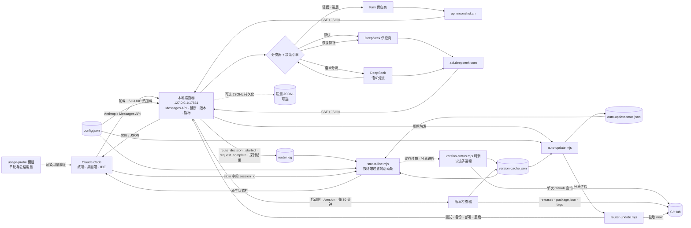

# Claude Model Router

[English](README.md) | **简体中文**

[](https://github.com/dragonxia-ctrl/claude-model-router/actions/workflows/ci.yml)
[](https://nodejs.org/)
[](LICENSE)

一个本地、安全优先的 **Claude Code** 模型路由代理：默认使用 DeepSeek，只有在公开 benchmark 证据或任务执行信号明确表明 Kimi 更有优势时，才切换到 Kimi。

> **项目状态：** 早期公开版本。目前**仅支持 DeepSeek 和 Kimi**。
>
> 本项目是独立的社区项目，与 Anthropic、DeepSeek、Moonshot AI（月之暗面）均无任何隶属关系，也未获得其官方背书。Claude Code 是 Anthropic 的产品。

**版本信息：** [CHANGELOG.md](CHANGELOG.md) 记录每个版本的改动。当前版本：**v1.6.2**；截至 1.2.0 的实测记录仍保留在 [VERSIONS.md](VERSIONS.md)（英文）。

---

## 项目动机

Claude Code 通常只为会话配置一个模型。但实际工作负载是混合的：

- 日常编码、重构、Kaggle、数据科学、金融和法律任务通常**不需要**最昂贵的模型；
- 真正的长程终端任务、需要多来源交叉验证的困难研究、前沿数学、复杂视觉推理和视频任务，可能更适合更强的模型；
- 手动切换模型会打断工作流程，而且很容易忘记。

本项目在 `127.0.0.1` 上启动一个轻量 HTTP 代理，位于 Claude Code 与模型供应商之间。Claude Code 只看到一个本地端点；代理为每个请求选择 DeepSeek 或 Kimi，再将响应流式传回，并处理跨供应商对话内容的兼容问题。

**核心原则：** 只有在 Kimi 具有明确、可说明优势的任务类别中使用 Kimi，其余任务一律默认 DeepSeek。

---

## 功能特性

- 将 Claude Code 的 Anthropic Messages API 兼容流量转发给 DeepSeek 或 Kimi。
- 日常编码、架构设计、重构、修 bug、Kaggle、数据科学、金融、法律和一般问题默认走 **DeepSeek**；任务长或难本身不会自动触发 Kimi。新对话从 DeepSeek 开始，不会继承其他对话的 Kimi 驻留状态，即使两条对话的第一句话相同。
- 以下任务会使用 **Kimi**：
  - 真正的视频媒体块；
  - 真正的长程、自主项目交付；
  - 需要检索并交叉核验来源的困难多步研究；
  - 研究级数学与证明；
  - 复杂视觉推理。
  文本启发式规则和语义 triage 只作用于交互式流式请求；非流式的辅助调用保持默认供应商。
- 根据**执行进展信号**升级，而不是简单统计工具调用次数：
  - 修改后验证反复失败；
  - 相同错误签名反复出现；
  - 工具连续失败；
  - 很长的修改型工具调用序列；
  - 完全相同的修改操作不断重复。
- 对较长且未被规则归类的任务，可选调用 DeepSeek 进行低成本语义分流。分流关闭 thinking、只返回小型 JSON、结果有缓存；任何错误、超时或低置信度都安全回退到 DeepSeek。
- 同一任务的 Kimi 粘性有上限：在工具循环内避免切换，但在检查点（新用户消息，或长回合内每 12 次新工具调用 / 每 6 次 Kimi 请求 / 每 5 分钟的中途复查）且近期执行已恢复时，会试探性降级到 DeepSeek；失败则回退并指数退避。
- 跨供应商时清理不兼容的 thinking / redacted_thinking 内容块。
- 在 Claude Code 原生状态栏显示当前 router 版本与最新发布版本、当前终端的模型活动条，以及更新提示（命令行可用 `claude-router version` 查看同样信息）。
- 开启 `updates.auto` 后，可自动安装新的已发布版本，走与手动命令完全相同的验证流程。
- 支持通过模型名或开头的 `[kimi]` / `[deepseek]` 标记显式指定供应商；问题里普通提到“使用 Kimi”不会切换供应商。

**暂不支持：** OpenAI、Gemini、Groq、本地模型，以及 DeepSeek 与 Kimi 之外的任何供应商。新增供应商属于架构变更，而不是改一个配置项；请阅读 [CONTRIBUTING.md](CONTRIBUTING.md)。

---

## 底层架构



左侧是请求路径。状态栏和自动更新是旁路：状态栏渲染只读本地文件，缓存过期刷新和每次安装都以分离子进程运行，因此都不会阻塞请求。健康检查、版本、指标和路由控制端点由同一个路由器进程提供，不在请求路径上。

### 核心组件

| 路径 | 职责 |
| --- | --- |
| `src/router.mjs` | HTTP 服务、配置加载、信号处理、优雅退出 |
| `src/handler.mjs` | 本地鉴权、端点分发、预览、上游转发 |
| `src/classifier.mjs` | 句首显式标记/别名、benchmark 优势规则、进展规则 |
| `src/task-text.mjs` | 提取主任务文本、短追问继承 |
| `src/progress.mjs` | 区分只读/修改工具，识别失败验证、重复错误等信号 |
| `src/decision-engine.mjs` | 有界 Kimi 驻留、恢复检查点/探针、语义缓存 |
| `src/deescalation.mjs` | 干净恢复窗口、探针失败分类、恢复确认与有上限的指数退避 |
| `src/latency.mjs` | 可选的供应商速度测量与延迟压力状态 |
| `src/semantic.mjs` | 单次 DeepSeek 低成本分类，关闭 thinking |
| `src/sanitize.mjs` | 清理 thinking；为每个 DeepSeek assistant 回合补齐 thinking 块 |
| `src/upstream.mjs` | SSE 流式透传、鉴权头、取消请求 |
| `src/health.mjs` | 存活、就绪与需鉴权的深度健康检查 |
| `src/telemetry.mjs` | 请求/token 指标、Prometheus 与 JSON 导出、可选有界 JSONL 持久化 |
| `src/usage.mjs` | 从 JSON/SSE 中提取 token 用量，响应字节原样透传 |
| `src/views.mjs` | 兼容用健康摘要与需鉴权的 `/v1/models` 响应 |
| `src/http-utils.mjs` | 本地 token 鉴权、JSON/错误响应、128 MiB 请求体上限 |
| `src/config-store.mjs` | 配置校验、原子热加载 |
| `src/session.mjs` | 对 Claude Code 会话 id 做哈希，日志里只出现 16 位标记 |
| `src/activity.mjs` | 把日志事件转换为按会话过滤的活动格与进行中请求 |
| `src/status-line.mjs` | 原生状态栏：模型活动条、耗时、版本；只读本地文件 |
| `src/version.mjs` | 发布版本查询、共享版本缓存、更新状态 |
| `src/auto-update.mjs` | 自动更新周期检查、分离式安装、失败退避 |
| `scripts/router-update.mjs` | 可验证更新：检出、测试、备份、重启、健康检查、回滚 |
| `scripts/router-control.mjs` | `state` 与 `deescalate` 控制端点客户端 |
| `scripts/version-status.mjs` | 状态栏版本段；读本地缓存，并节流启动分离刷新 |
| `scripts/healthcheck.mjs`、`scripts/verify-live.mjs`、`scripts/verify-deployment.mjs` | 安装后、真实供应商与部署验证 |
| `scripts/lib/install-core.mjs` | 安全安装、备份、回滚、卸载 |
| `scripts/lib/` | 安装、诊断、Docker、设置、路径与真实请求客户端等辅助模块 |
| `mods/usage-probe/` | Claude Code 终端模组：单轮/会话用量脚注、`/router-usage` |
| `bin/claude-router.mjs` | 用户命令行入口 |

### 一次请求如何被处理

1. Claude Code 向 `http://127.0.0.1:17861` 发送 `POST /v1/messages` 或 `count_tokens`。
2. 路由器验证本地 Bearer token。
3. 从最近一条实质性用户消息提取任务文本；“continue”“继续”等短追问继承之前的任务。会话键由用户 id、会话标记和首个任务共同哈希，因此不同终端的相同首句不会共享 Kimi 驻留状态。
4. 决策引擎依次评估：
   - 模型别名、句首 `[kimi]`/`[deepseek]` 标记或句首 `force` 指令；
   - Kimi 明确优势任务规则；
   - 基于进展的升级信号；
   - 工具循环内保持 Kimi 粘性，并在检查点（新用户消息、请求/工具/时间窗口或手动请求）执行 DeepSeek 恢复探针；
   - 可选语义分流；
   - 以上均不满足时使用 DeepSeek。
5. 将 `auto` 替换为所选供应商的真实模型名。
6. 按目标供应商清理 thinking 内容：移除 redacted 块和跨供应商签名，并为每个 DeepSeek assistant 回合补齐 thinking 块。
7. 使用对应供应商的 API key 转发请求。
8. 响应状态码、Content-Type、SSE 数据块和重试头原样传回。
9. 结构化日志记录解析后的供应商与模型、客户端请求的模型名、原因、来源、是否流式、进展统计、会话/任务键、16 位会话标记、能力/媒体类型、降档检查点与结果以及 Kimi 驻留计数；探针尝试另写 `deescalation_probe_outcome`。不记录提示词、会话 UUID 和 API key。

### 路由原则

默认策略有意保持保守。它参考了截至 2026 年 11 月检索到的公开比较；benchmark 会变化，因此策略也应随新证据更新。

| 工作负载 | 所采用的公开信号 | 默认选择 |
| --- | --- | --- |
| 日常编码、架构、重构 | DeepSeek 在 FrontierCode / DeepSWE 类比较中相当或更好 | DeepSeek |
| Kaggle、数据科学、金融、法律 | 所检索比较中 DeepSeek 相当或更好 | DeepSeek |
| 长程、终端密集型 agent 任务 | Kimi 在 Terminal-Bench 类比较中有明显优势 | 真正长程或执行进展恶化时用 Kimi |
| 困难工具辅助研究 | Kimi 在 HLE 类任务中有优势 | 面向来源核验的多步研究使用 Kimi |
| 前沿数学、复杂视觉推理 | Kimi 有优势 | Kimi |
| 视频媒体块 | 只有 Kimi 能处理视频 | Kimi（硬能力，不自动降级） |

Kimi 不再永久粘滞。默认完成 4 次 Kimi 请求后，如果近期执行窗口干净且到达检查点，会发起 2 次 DeepSeek 探针请求；检查点是新用户消息，或长回合内每 12 次新工具调用、每 6 次 Kimi 请求、每 5 分钟（以先到者为准）的中途复查，因此单个长回合不再无限期锁定 Kimi。出现新失败则回到 Kimi，并采用有上限的指数退避；连续 3 次探针失败后，会在超过 16 次 Kimi 请求后的第一个干净检查点重新尝试，而不是永久锁定。只有真正的视频媒体块不会自动降级；文本里提到视频不算能力要求，非流式的辅助调用保持默认供应商。显式模型选择始终优先。`claude-router state` 和 `claude-router deescalate` 可以查看当前驻留状态并手动安排恢复检查点。

完整规则、可调参数和开源设计参考见 [docs/routing-policy.md](docs/routing-policy.md)。

---

## 安全设计

修改 Claude Code 设置会影响整台机器上的所有 Claude Code 会话，本项目将它视为高风险操作。

- **默认 dry-run。** `npm run setup` 只展示计划，只有显式传入 `--apply` 才会写入。
- **只修改受管字段。** 安装器只修改 `model`、`apiKeyHelper` 和四个路由用 `ANTHROPIC_*` 环境值，并移除会绕过路由器的旧认证字段；其他设置保持不变。
- **带时间戳的备份。** 写入前备份 `settings.json`、`config.json` 和安装清单。
- **原子写入。** 先写临时文件，再重命名替换目标文件。
- **自动回滚。** Docker 启动或健康检查失败时，自动恢复 `settings.json` 并清理失败的安装清单。
- **安全卸载。** `uninstall` 同样默认 dry-run；若安装后用户修改过 `settings.json`，则拒绝覆盖，除非检查警告后显式传入 `--force`。
- **拒绝 root 安装。** POSIX 系统默认拒绝 root 执行，只有 `--allow-root` 可显式覆盖。
- **供应商 key 不进入 Claude 设置。** 供应商 key 仅保存在权限受限的 router 配置文件中；Claude Code 只调用本地 token helper。
- **容器加固。** 容器根文件系统只读、删除全部 capabilities、启用 `no-new-privileges`、配置目录只读挂载，端口只绑定 `127.0.0.1`。
- **仓库不保存秘密。** 本地配置、token、备份、日志和环境文件均已加入 `.gitignore`。

在共享或受管环境部署前，请阅读 [SECURITY.md](SECURITY.md) 与 [docs/security.md](docs/security.md)。

---

## 环境要求

| 要求 | 说明 |
| --- | --- |
| Claude Code | 已在 macOS 上使用 Claude Code `2.1.331` 做过真实集成验证；使用相同 Anthropic 兼容设置的较新版本应可工作 |
| Node.js | 20 或更高版本，用于安装器、CLI 和离线测试 |
| Docker | macOS/Windows 使用 Docker Desktop，Linux 使用 Docker Engine；推荐流程需要 Compose v2 |
| 供应商账号 | 一个 DeepSeek API key 和一个 Kimi（Moonshot）API key |
| 网络 | 可出站 HTTPS 访问 `api.deepseek.com` 和 `api.moonshot.cn` |

### 操作系统支持

| 平台 | 安装器 / CLI / 测试 | Router 运行方式 |
| --- | --- | --- |
| macOS（Intel / Apple Silicon） | 支持 | Docker Desktop（推荐）或手动 Node |
| Linux x64 / arm64 | 支持 | Docker Engine（推荐）或手动 Node |
| Windows 10 / 11 | 支持 | Docker Desktop + WSL2 后端 |
| CI | Ubuntu、macOS、Windows；Node 20 / 22 / 24 | Ubuntu 上构建并测试容器 |

Windows 注意事项：

- 请使用 **PowerShell** 或 **Windows Terminal**；
- Docker Desktop 应使用 WSL2 后端；
- 生成的设置命令支持包含空格的路径；
- 容器端口只绑定主机 `127.0.0.1`。

---

## 快速开始（推荐 Docker）

### 1. 克隆项目

```bash
git clone https://github.com/dragonxia-ctrl/claude-model-router.git
cd claude-model-router
```

### 2. 预览安装

```bash
npm run setup
```

这一步不会写入任何内容，只显示数据目录、设置路径、受管变更以及现有 key 状态。

### 3. 执行安装

```bash
npm run setup -- --apply
```

程序会提示输入 Kimi 和 DeepSeek key，输入不会回显。已有 key 时直接回车即可保留。非交互环境可使用：

```bash
export CLAUDE_ROUTER_KIMI_KEY="..."
export CLAUDE_ROUTER_DEEPSEEK_KEY="..."
npm run setup -- --apply
```

PowerShell：

```powershell
$env:CLAUDE_ROUTER_KIMI_KEY = "..."
$env:CLAUDE_ROUTER_DEEPSEEK_KEY = "..."
npm run setup -- --apply
```

安装器会：

1. 在写入前检查 key；
2. 将私有配置写入 `~/.claude/model-router`（或 `--data-dir`）；
3. 备份并合并 `~/.claude/settings.json`（或 `--settings`）；
4. 构建并启动 Docker 容器；
5. 等待 `/health` 正常；
6. 如果启动失败，自动回滚设置。

### 4. 完全重启 Claude Code

重启终端、桌面端和 IDE 中的 Claude Code，使它们重新读取 `~/.claude/settings.json`。

### 5. 验证部署

```bash
npm run doctor
npm run verify
```

`doctor` 检查 Node、配置权限、Claude 设置、token helper、安装清单、Docker Compose 和 router 健康状态。`verify` 发起一次小型真实请求，并检查实际路由模型。

### 6. 可选：完整真实 API 测试

```bash
npm run verify:live -- --yes
```

这会消耗真实 token，绝不会由 `setup` 或 CI 自动运行。

---

## 手动部署

如果你不希望安装器修改 `settings.json`，可使用此流程。

### 1. 创建配置

```bash
mkdir -p ~/.claude/model-router
cp config/config.example.json ~/.claude/model-router/config.json
chmod 600 ~/.claude/model-router/config.json
```

将 token 替换为新的 64 位十六进制字符串，并填入两个供应商 key。生成 token：

```bash
node -e "console.log(require('crypto').randomBytes(32).toString('hex'))"
```

### 2. 启动容器

macOS / Linux：

```bash
export CLAUDE_ROUTER_DATA_DIR="$HOME/.claude/model-router"
export CLAUDE_ROUTER_PORT=17861
docker compose up -d --build
```

PowerShell：

```powershell
$env:CLAUDE_ROUTER_DATA_DIR = "$HOME\.claude\model-router"
$env:CLAUDE_ROUTER_PORT = "17861"
docker compose up -d --build
```

检查：

```bash
curl http://127.0.0.1:17861/health
```

### 3. 合并 Claude Code 设置

将下列字段合并进 `~/.claude/settings.json`，不要覆盖其他无关设置：

```json
{
  "model": "auto",
  "apiKeyHelper": "\"<node 的绝对路径>\" \"<local-token.mjs 的绝对路径>\"",
  "env": {
    "ANTHROPIC_BASE_URL": "http://127.0.0.1:17861",
    "ANTHROPIC_MODEL": "auto",
    "ANTHROPIC_DEFAULT_MODEL": "auto",
    "ANTHROPIC_SMALL_FAST_MODEL": "deepseek-flash"
  }
}
```

生成 helper（此命令不会修改 Claude 设置）：

```bash
node bin/claude-router.mjs token-helper
```

将命令输出的 `apiKeyHelper` 值填入上面的设置示例。此命令只写入 `local-token.mjs`。

从 `settings.env` 中删除 `ANTHROPIC_AUTH_TOKEN` 或 `ANTHROPIC_API_KEY`；它们会绕过本地 helper 并导致 401。

### 4. 重启并验证

```bash
node bin/claude-router.mjs status
node bin/claude-router.mjs verify
```

---

## 配置说明

实际配置位于 `~/.claude/model-router/config.json`，不会被提交。

```json
{
  "router": {
    "host": "127.0.0.1",
    "port": 17861,
    "token": "<64 位本地 token>"
  },
  "providers": {
    "kimi": {
      "baseUrl": "https://api.moonshot.cn/anthropic",
      "model": "kimi-k3.1-pro",
      "apiKey": "<Kimi key>"
    },
    "deepseek": {
      "baseUrl": "https://api.deepseek.com/anthropic",
      "model": "deepseek-flash",
      "apiKey": "<DeepSeek key>"
    }
  },
  "routing": {
    "semanticTriage": true,
    "triageMinChars": 40,
    "triageConfidence": 0.8,
    "triageTimeoutMs": 8000,
    "triageMaxInputChars": 6000,
    "deescalation": {
      "enabled": true,
      "minKimiRequests": 4,
      "probeRequests": 2,
      "maxAttempts": 3,
      "maxBackoffRequests": 16,
      "windowToolCalls": 12,
      "windowRequests": 6,
      "windowMs": 300000,
      "retryAfterExhaustedRequests": 16,
      "minFailureDenominator": 10,
      "relapseConfirmations": 2,
      "latencyCheckpoint": {
        "enabled": false
      }
    }
  },
  "telemetry": {
    "persist": false,
    "retentionDays": 30,
    "maxFileBytes": 33554432
  }
}
```

| 配置项 | 含义 |
| --- | --- |
| `router.token` | Claude Code 访问本地 router 使用的 Bearer token，不是供应商 key |
| `providers.*.baseUrl` | 供应商的 Anthropic 兼容端点 |
| `providers.*.model` | 转发给上游的模型名 |
| `routing.semanticTriage` | 是否启用可选 DeepSeek 语义分类 |
| `routing.triageMinChars` | 触发语义分流的最短任务文本长度 |
| `routing.triageConfidence` | 选择 Kimi 所需的最低置信度 |
| `routing.triageTimeoutMs` | 分类器超时 |
| `routing.triageMaxInputChars` | 发送给分类器的最大任务字符数 |
| `routing.deescalation` | 有界 Kimi 驻留、恢复探针、退避与可选的延迟检查点（默认关闭）；详见[路由策略](docs/routing-policy.md) |
| `updates` | 可选：自动安装已发布版本（`auto`）、源码 checkout（`source`）与 launchd 标签（`launchdLabel`）；见[从 GitHub 更新](#从-github-更新) |
| `telemetry` | 可选私有 JSONL 持久化、保留与轮转；详见[可观测性](docs/observability.md) |

语义分类器只接收截断后的当前任务文本，不接收工具结果、文件内容或完整对话。

后续更换 key：

```bash
node bin/claude-router.mjs configure
```

---

## 日常运维

```bash
npm run status                  # 健康摘要
npm run doctor                  # 环境和部署检查
npm run compose:down            # 停止容器
npm run compose:up              # 构建/启动并等待健康
node bin/claude-router.mjs restart
node bin/claude-router.mjs logs --tail 200
```

### 从 GitHub 更新

如果 router 以本地服务形式从 git checkout 运行（即 `~/.claude/model-router` 的扁平布局），一条命令即可完成：拉取 `main`、校验 checkout 与 `origin/main` 一致且 `package.json` 与 `src/version.mjs` 版本相同、运行离线测试、带备份部署运行文件、重启服务，并验证健康状态、`/version` 和一次路由预览。

```bash
claude-router update             # 或：node scripts/router-update.mjs
claude-router update --dry-run   # 只显示将要部署的内容
```

如果 checkout 不在 `main` 上有未提交改动，它会拒绝执行；已是最新时直接提示且不改动任何文件；重启或验证失败会恢复之前的文件。Docker 安装则使用 `git pull` 后执行 `npm run compose:up`。

#### 自动更新

服务式安装可以让 router 自己安装新版本。开关默认关闭：

```bash
claude-router update --auto on     # 开启自动安装
claude-router update --auto off    # 关闭
claude-router update --auto        # 查看开关、最近一次尝试及其错误
```

开启后，运行中的 router 会自动安装更新的已发布版本。它把同一个更新器作为独立进程启动，避免 launchd 重启把校验进程一并杀掉：拉取并校验干净的 `main`、运行离线测试、带备份部署、重启服务，并验证健康状态、`/version` 和一次路由预览。输出写入 `router.log` 旁边的 `auto-update.log`。失败后一小时内部重试，状态栏显示 `auto-update failed`；`claude-router update --auto` 会打印记录的错误。

要求与限制：

- 源码 checkout（`updates.source`，默认 `~/claude-model-router`）必须位于 `main` 且没有未提交改动，与手动更新相同。
- 服务必须能由 launchd 重启；Docker 安装不使用自动安装，仍用 `git pull` 后执行 `npm run compose:up`。
- 已发布版本取 `main` 上的 `package.json` 版本（或在有 GitHub release/tag 时取最新版本）。没有提升版本号的普通提交不会被自动安装。
- 如果文件已部署但服务尚未重启（例如 `--restart none`），状态栏显示 `update installed, restart to update`。
- 打开或关闭开关只会改写 `config.json` 中的 `updates.auto`，并向运行中的 router 发送 SIGHUP，立即生效。

可用端点：

| 端点 | 用途 |
| --- | --- |
| `GET /health` | 旧版健康摘要 |
| `GET /health/live` | 无需鉴权的进程存活检查 |
| `GET /health/ready` | 配置与供应商就绪状态；无可用供应商时返回 503 |
| `GET /health/deep` | 鉴权后的被动诊断，不消耗供应商 token |
| `GET /version` | 无需鉴权的当前版本、最新发布版本与更新可用状态 |
| `GET /metrics` | 鉴权后的 Prometheus 请求、token、路由与恢复指标 |
| `GET /metrics/json` | 鉴权后的 JSON 遥测快照 |
| `GET /v1/models` | 向 Claude Code 暴露 `auto`、DeepSeek、Kimi |
| `POST /v1/router/preview` | 只预览路由决策，不调用所选上游 |
| `GET /v1/router/state` | 需认证：查看内存中的 Kimi 驻留与探针状态 |
| `POST /v1/router/deescalate` | 需认证：手动安排恢复检查点（`conversationKey` 或 `all: true`） |
| `POST /v1/messages` | 主代理端点 |
| `POST /v1/messages/count_tokens` | 通过所选供应商计算 token |

健康语义、持久化与隐私、Prometheus 示例，以及位于回合耗时页脚上方的终端 usage probe，见 [docs/observability.md](docs/observability.md) 和 [mods/usage-probe](mods/usage-probe/README.md)。

### 终端用量探针

从仓库 marketplace 安装后重启 Claude Code：

```text
/plugin marketplace add dragonxia-ctrl/claude-model-router
/plugin install usage-probe@claude-model-router
```

每个回合完成后，原生耗时页脚上方会显示 DeepSeek/Kimi 的 token 总量、比例和模型请求耗时；`/router-usage` 可查看详细拆分。该探针仅支持终端，不需要供应商 key。

### 在 Claude Code 中显示版本

`GET /version` 返回当前运行版本、最新发布版本与更新可用状态；运行中的 router 会把同样的状态写入 `~/.claude/model-router/version-cache.json`，在启动时检查一次，之后至多每 30 分钟一次（离线时静默跳过，并保留上次已知版本）。

要在 Claude Code 里看到它，使用原生状态栏（也就是 Claude Code 自己显示版本和升级提示的位置）。在 `~/.claude/settings.json` 中加入以下配置并重启 Claude Code：

```json
"statusLine": {
  "type": "command",
  "command": "node \"$HOME/.claude/model-router/version-status.mjs\""
}
```

（`version-status.mjs` 对应仓库中的 `scripts/version-status.mjs`；手动部署时把它复制到数据目录。）

同一个配置也可以指向 `status-line.mjs`，它会在版本段前面加上模型活动条：

```json
"statusLine": {
  "type": "command",
  "command": "node \"$HOME/.claude/model-router/status-line.mjs\""
}
```

它从 Claude Code 通过 stdin 传入的 JSON 读取 `session_id`，显示成 `● Kimi 12s  ███…  router v1.6.2 · latest v1.6.2`：当前处理请求的模型、最近 80 秒的 DeepSeek（蓝色）/Kimi（琥珀色）流量，以及下面同样的版本状态。当 router 日志带有会话标记时，只显示本终端的活动（Claude Code 请求现在总会带标记；旧日志则显示全局视图）。`CLAUDE_ROUTER_CELLS` 和 `CLAUDE_ROUTER_CELL_MS` 可以调整采样窗口。`claude-router update` 会把活动条和运行时一起部署（`src/status-line.mjs`、`src/activity.mjs`、`src/session.mjs`）。

状态栏的渲染路径只读本地文件，显示规则：

- 运行版本已是最新时，暗色显示 `router v1.6.2 · latest v1.6.2`。
- 有新版本时，琥珀色显示 `router v1.6.2 · v1.6.3 available`；开启自动更新后追加 `· auto-update on`、`· auto-update running` 或 `· auto-update failed`。
- 部署的 `version.mjs` 比运行进程更新时，琥珀色显示 `router v1.3.0 · update installed, restart to update`。

当缓存的检查结果超过十分钟时，脚本会启动一个带节流的独立 `--refresh` 子进程向 GitHub 查询一次并更新缓存；因此即使 router 从未重启，新版本也会及时显示。失败时静默，多个 Claude Code 窗口共用一个刷新名额。不使用供应商 token；router 从未上报版本时不输出任何内容。在 Claude Code 之外，`claude-router version` 会打印相同的版本信息和自动更新开关。

---

## 测试

### 离线测试（不调用 API，不需要 Docker）

```bash
npm test
```

当前测试覆盖：

- 默认 DeepSeek 和 Kimi 优势任务；
- Kaggle 交叉验证、端到端模型训练等误升级回归；
- 短追问任务继承；
- 只读与修改型进展信号；
- 验证失败、重复错误、重复修改；
- 有界 Kimi 驻留、检查点探针、复发回退、指数退避与硬能力锁；
- 语义分流成功、缓存、置信度阈值和失败回退；
- 配置校验与热加载；
- HTTP 鉴权、模型替换、SSE、查询参数兼容、预览与粘性；
- 健康/指标端点、真实 usage 提取与匿名化遥测持久化；
- 安装 dry-run、设置合并、备份、回滚和安全卸载；
- 跨平台路径处理。

### 容器内测试（贡献者推荐）

```bash
docker build -t claude-model-router:test .
docker run --rm --network none --tmpfs /tmp \
  -v "$PWD:/work:ro" -w /work \
  claude-model-router:test \
  node --test test/run.mjs
```

### 真实供应商验证（显式启用）

```bash
npm run verify            # 一次小型真实请求
npm run verify:live -- --yes
```

完整真实测试覆盖显式选择、自动路由、流式响应、语义分流、两个供应商的工具调用与工具结果，以及双向跨供应商切换。它会消耗真实 token。

### CI

GitHub Actions 在 Ubuntu、macOS、Windows 上，使用 Node 20、22、24 运行离线测试矩阵；另一个 Linux job 构建 Docker 镜像，并在无网络容器内运行测试。

测试设计见 [docs/testing.md](docs/testing.md)；本次打包已完成的检查和明确尚未验证的平台见 [docs/verification.md](docs/verification.md)。

---

## 卸载

先预览：

```bash
node bin/claude-router.mjs uninstall
```

确认执行：

```bash
node bin/claude-router.mjs uninstall --apply
```

卸载会停止容器，并只根据安装清单恢复 router 管理的设置。本地配置和备份会保留。如果安装后 `settings.json` 有改动，请在检查警告后使用 `--force`；无关修改仍会保留。

完成后重启 Claude Code。

---

## 故障排查

### `401 Invalid local token`

- 确认 `apiKeyHelper` 指向存在的 `~/.claude/model-router/local-token.mjs`；
- 再运行一次 `npm run setup -- --apply`，重新生成 helper 命令；
- 从 `settings.env` 和 shell 配置中删除 `ANTHROPIC_AUTH_TOKEN` / `ANTHROPIC_API_KEY`；
- 重启 Claude Code。

### `127.0.0.1:17861` 连接被拒绝

```bash
docker compose ps
npm run doctor
node bin/claude-router.mjs logs
```

确认 Docker Desktop / Engine 正在运行，且端口没有被其他进程占用。

### `deepseek key missing` / `kimi key missing`

```bash
node bin/claude-router.mjs configure
```

### Claude Code 显示 `unrecognized_model: auto`

`auto` 是 router 的占位符，不是 Anthropic 模型 ID。该提示只是表面警告，请求仍会由本地 router 分流；使用 `npm run verify` 可确认实际上游模型。

### 语义分流没有运行

- 任务文本必须至少达到 `triageMinChars`；
- 已命中明确证据规则时会跳过语义分流；
- 分类失败会记录 `semantic_triage_fallback` 并使用 DeepSeek。

### 设置已修改但没有生效

重启**所有** Claude Code 使用界面。桌面端和 IDE 可能仍在内存中保留旧设置。然后执行：

```bash
npm run doctor
```

---

## 项目结构

```text
.
├── bin/                 CLI 入口
├── src/                 路由、分类、进展分析、语义分流
├── scripts/             安装、doctor、验证、Docker 辅助
├── test/                离线测试
├── docs/                架构、路由策略、安全、测试文档
├── config/              仅包含示例配置
├── compose.yaml         加固的容器部署
├── Dockerfile
├── CONTRIBUTING.md
├── VERSIONS.md            版本专区：改动内容、原因与实测证据
├── SECURITY.md
└── LICENSE
```

---

## 参与贡献

特别欢迎以下贡献：

- 补充误升级 Kimi 或漏升级的回归用例；
- 修复跨平台安装器 / Docker 问题；
- 改进文档；
- 审查设置修改与回滚的安全性；
- 提供带可复现来源的 benchmark 证据。

提交 PR 前请阅读 [CONTRIBUTING.md](CONTRIBUTING.md) 和 [CODE_OF_CONDUCT.md](CODE_OF_CONDUCT.md)。不要在 issue 或 PR 中提交 API key、token、个人路径或供应商账号信息。

---

## 许可证与免责声明

MIT License，见 [LICENSE](LICENSE)。

本项目会修改本地 Claude Code 设置，并将提示词转发给第三方供应商。使用者需要自行负责：

- 遵守各供应商的服务条款和数据政策；
- 保护自己的 API key；
- 验证路由质量与费用是否符合自己的工作负载；
- 备份自己的配置。

作者不提供任何担保，也不对设置丢失、意外供应商费用或模型输出质量承担责任。
