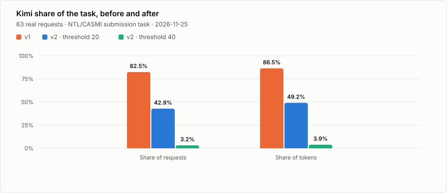
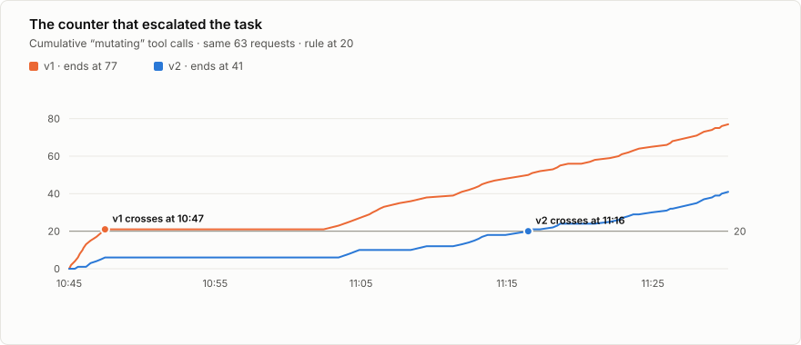
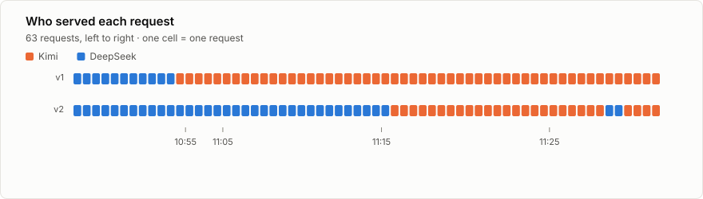
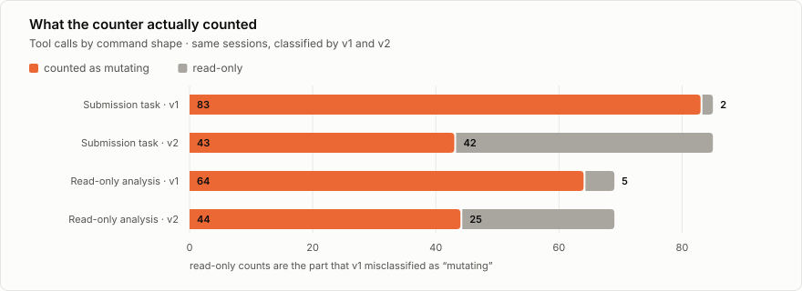

# v1 → v2: why a normal task ran 86% on Kimi

**Version report · 2026-11-25.** This document records the defect that v2 fixes, the measurements that identified it, and how the fix was validated. All numbers come from one real session replayed through both engines; the raw data is in [`data/v1-v2.json`](data/v1-v2.json) and the figures are generated from it by [`render-figures.mjs`](render-figures.mjs).

> Historical note: the capability rules described below ("video/visual capabilities never de-escalate") are the v1/v2 behaviour. v3 (1.3.0) replaced them with media-based detection — see [v2-to-v3.md](v2-to-v3.md).

---

## Abstract

A 45-minute task — submitting two Kaggle competitions and archiving the result — was served 82.5% by Kimi (86.5% of tokens) while the semantic triage classified it as ordinary coding on every call. Replaying the same 63 requests shows two compounding defects: the escalation counter treated read-only shell commands as file mutations, and the de-escalation check could only run when the user sent a new message, which never happened inside the single long turn. Fixing command classification and adding mid-turn recovery checkpoints lowers Kimi's share to 42.9% of requests (49.2% of tokens) without changing the routing policy, the defaults, or the safety rules.

---

## 1. Symptom

On 2026-11-25 the router served a real Claude Code session with:

- **63 main requests** between 10:45:24Z and 11:30:34Z;
- **52 of 63 requests (82.5%)** answered by Kimi;
- **86.5% of all tokens** (including cache reads) billed to Kimi;
- a task the semantic classifier labelled `ordinary_coding` with 0.90–0.95 confidence on every call, and a progress rule that fired once, at 10:47:51Z:

```
21 mutating tool calls: long-horizon execution
```

Everything after that line was `source: sticky`. No recovery probe ever ran: all 68 `deescalationOutcome` values in that session were `null`.

A second, independent session — a read-only investigation that only read logs and ran analysis scripts — was also switched to Kimi by the same rule.

## 2. What the router is deciding

For each request the router picks DeepSeek (default) or Kimi. Three inputs can escalate:

1. **Benchmark-advantage rules** on the task text (video, explicit long-horizon wording, research, frontier math, complex visual reasoning).
2. **Progress signals** computed from the conversation's tool history: failed verification cycles, repeated error signatures, consecutive failures, and *cumulative mutating tool calls* (threshold 20).
3. **Semantic triage**, a cheap DeepSeek call that may vote Kimi when confidence ≥ 0.8.

Once Kimi is selected for a task, the task stays there until a *recovery checkpoint* shows a clean recent window (≤10% failures, no repeated error groups, no mutation repeated more than twice); then two DeepSeek probe requests decide whether to stay.

## 3. Root cause

### 3.1 The escalation counter measured command shape, not work

`progress.mjs` classified each Bash command as `read`, `verification`, or `mutating`. Read required the whole command to match a small allowlist (`ls`, `cat`, `grep`, `git status`, …). Everything else counted as a mutation — including:

- `echo "=== files ===" && cat agent.yaml` (the extra `echo` disqualified the chain),
- `python3 - <<'PY' … json.load(open('router.log')) … PY` (read-only analysis),
- `kaggle competitions submissions -c name-that-llm` (a read-only API query).

Since the threshold is cumulative over the task and never resets within it, a task that mostly reads crosses 20 quickly. The rule was intended to detect long-horizon editing; it actually detected "the agent used the shell a lot".

### 3.2 The recovery checkpoint was unreachable inside a long turn

`decision-engine.mjs` defined a checkpoint as *a new user message*:

```js
const checkpoint = previous.lastUserIndex !== decision.lastUserIndex;
```

A task executed as one long assistant turn has exactly one user message at its start. With no new message, the recovery window was never evaluated, so `sticky` held Kimi until the turn ended — for 51 consecutive requests in this task.

### 3.3 The log could not answer "why"

`route_decision` lines carried the provider, reason, source, and tool statistics, but not the conversation/task identifiers or the de-escalation outcome. Correlating a decision with a session required joining three sources (router log, telemetry, session transcript) by timestamp.

## 4. Evidence

### 4.1 End-to-end effect

Replaying the 63 real requests through v1 and v2 — identical bodies, semantic triage disabled so both engines see the same input — produces Table 1 and Figure 1.

**Table 1.** Kimi share of the measured task (63 requests, 2026-11-25).

| Configuration | Requests | Tokens |
|---|---:|---:|
| v1 | 82.5% | 86.5% |
| v2, threshold 20 | **42.9%** | **49.2%** |
| v2, threshold 40 | 3.2% | 3.9% |
| v2, threshold 60 | 0.0% | 0.0% |



**Figure 1.** Kimi share of the same 63-request task under v1 and v2. Threshold 40 is a configuration change (`routing.limits.mutatingCalls`), shown for comparison; the release keeps the default of 20.

The v2 threshold-20 run still uses Kimi for 27 requests — the task contains genuine file writes, and the escalation rule is deliberately preserved. What changes is *when* it escalates and that it can recover: escalation moves from 10:47 to 11:16, a clean window starts a DeepSeek probe at 11:28:54, and a later failure relapses to Kimi at 11:29:40. With threshold 40 the same task would escalate only near its end.

### 4.2 The counter, and when it fired

**Figure 2** plots the cumulative "mutating" count per request for both engines, with the escalation rule drawn at 20.



**Figure 2.** Cumulative “mutating” tool calls over the same 63 requests. v1 crosses 20 at 10:47; v2 crosses at 11:16 after read-only commands stopped counting. v1 ends at 77 counted mutations, v2 at 41.

**Figure 3** shows who served each request. v1 switches to Kimi at request ~10 and never returns; v2 stays on DeepSeek until the mid-task editing phase, escalates, then probes and relapses.



**Figure 3.** One cell per request; orange = Kimi, blue = DeepSeek. The v1 strip is the visible signature of the unreachable checkpoint.

### 4.3 What the counter counted

**Table 2** classifies every tool call in the two real sessions with the v1 and v2 rules. The difference is entirely commands that do not write.

**Table 2.** Tool calls by command shape, same sessions, two classifiers.

| Session (tool calls) | v1 mutating | v1 read-only | v2 mutating | v2 read-only |
|---|---:|---:|---:|---:|
| Submission task (85) | 83 | 2 | 43 | 42 |
| Read-only analysis (69) | 64 | 5 | 44 | 25 |



**Figure 4.** Stacked tool-call counts by command shape. The grey part is the work v1 misclassified as mutation; v2 still counts every real write (43 on the submission task).

### 4.4 Replay validity

Before comparing engines, the replay must reproduce what actually happened. The v1 engine, run on reconstructed message histories, reproduced **63/63** logged provider decisions. The reconstruction therefore carries the same tool history, failures, and user boundaries that drove the original decisions; the comparison isolates the code change rather than a difference in inputs.

## 5. The fix

| Area | Change | File |
|---|---|---|
| Command classification | `echo`/`printf`/… chains, read-only CLIs (`kaggle … status\|list\|files\|leaderboard\|submissions`, `pip list/show`), and inline Python with no write operation are `read`. Script files remain `mutating`; any write marker (`open(...,'w')`, `.write`, `.to_parquet`, `os.remove`, `shutil.`, `subprocess`, shell redirection) keeps the call `mutating`. | `src/progress.mjs` |
| Recovery checkpoint | While a task is on Kimi, the same 24-tool-call recovery window is evaluated every 24 *new* tool calls, not only on a new user message. Backoff (`minKimiRequests`), probe length (`probeRequests`), hard-capability locks, and relapse handling are unchanged. | `src/decision-engine.mjs` |
| Observability | `route_decision` logs now include `conversationKey`, `taskKey`, and `deescalationOutcome`. | `src/handler.mjs` |

A blocked recovery window is retried after another 24 tool calls. Hard capabilities (video, complex visual reasoning) still never probe. The default provider and every other rule are unchanged.

### 5.1 Also in v2: version visibility

v1 exposed no release identity at all: `/health` carried only an internal schema number, so there was no way to ask "which router am I running, and is it current?". v2 adds `src/version.mjs` (running release plus a cached GitHub release check), `GET /version`, a `release` field on `/health`, `claude-router version`, and `scripts/version-status.mjs`, which renders `router v1.2.0 · latest v1.2.0` in Claude Code's native status line and turns amber with `router v1.2.0 · v1.3.0 available` when a newer release exists. The status line helper reads only the local cache file; the update check is one unauthenticated GitHub read at startup and at most every six hours, silent when offline. Version visibility deliberately does not use the usage-probe mod: mod hooks run in a sandbox without `fetch`, `process`, or filesystem access.

## 6. Verification

- **Test suite:** 76 tests pass (49 before this release). Six cover command classification, mid-turn recovery, and the log fields; ten cover the update checker and the `/version` endpoint; four cover the status line output; seven cover the updater. One existing test changed expectation because a clean window now probes mid-turn instead of waiting for the next user message.
- **Live check** on the deployed instance, using the read-only preview endpoint: 25 read-only `echo && cat` commands → DeepSeek with `mutating=0`; 19 file writes → DeepSeek; 21 file writes → Kimi with source `evidence`; recent `route_decision` lines carry both keys and an `deescalationOutcome` field. `GET /version` answers `{"current":"1.2.0", …}`, and the configured status line command prints `router v1.2.0` (dimmed) and, against a fixture cache with a newer release, `router v1.2.0 · v1.3.0 available` (amber).
- **Behaviour unchanged where it should be:** the 20-mutation rule still escalates real editing work, hard capabilities never de-escalate, and a failed probe still returns to Kimi with exponential backoff.

## 7. Threats to validity

- **One task, not a benchmark.** The measurements describe one real session. The mechanism (a cumulative counter fed by false positives, plus an unreachable checkpoint) is structural, but the exact percentages are task-specific.
- **No output-quality measurement.** The router decides routing, not correctness; this report does not claim DeepSeek produced better work after de-escalation, only that the routing rule stopped over-selecting Kimi.
- **Reconstruction.** Bodies were rebuilt from the session transcript and the logged tool statistics. The 63/63 reproduction bounds, but does not eliminate, reconstruction error.
- **Token accounting.** Token shares include cache reads, which are provider-specific and dominate long sessions.
- **Reader-facing summary.** The threshold-40 row is a configuration what-if, not the default.

## 8. Reproduction

```sh
node docs/versions/render-figures.mjs   # regenerate assets/*.svg from data/v1-v2.json
npm test                                # 76 offline tests
```

The figures are generated from [`data/v1-v2.json`](data/v1-v2.json), which contains, per request: timestamp, provider under each engine, decision source, cumulative tool and mutating counts, and token usage — no prompts, commands, or identifiers.
