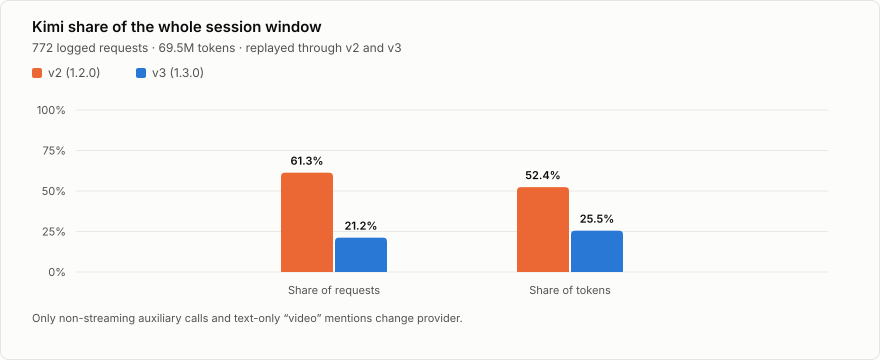
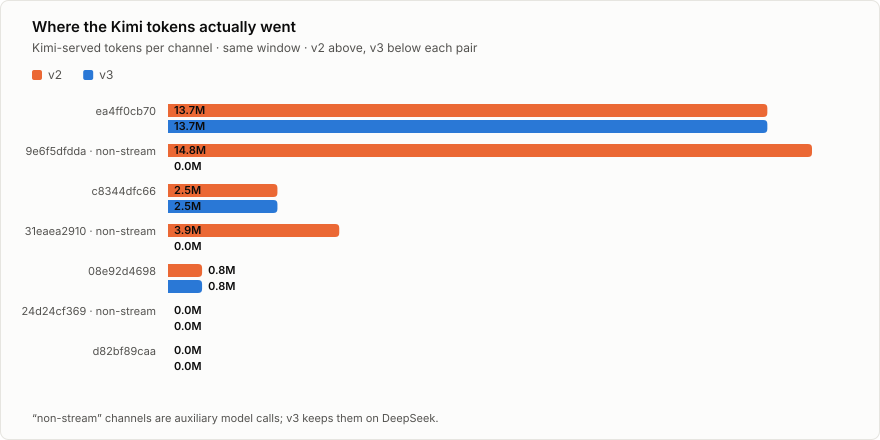

# v2 → v3: why auxiliary calls ran 100% on Kimi

**Version report · 2026-11-26.** This document records the routing defect that v3 fixes, the measurements that identified it, and how the fix was validated. All numbers come from the live router log; the raw aggregates are in [`data/v2-v3.json`](data/v2-v3.json), regenerated by [`replay-v3.mjs`](replay-v3.mjs), and the figures by [`render-figures.mjs`](render-figures.mjs).

---

## Abstract

After v2, some answers were still served entirely by Kimi. The visible-answer part was working as designed: a long tool-heavy turn escalated when its cumulative mutating-call counter reached 20 and stayed on Kimi until a recovery checkpoint. The real defect was elsewhere. Two **auxiliary, non-streaming** channels — short model calls whose answers are a handful of tokens — were hard-locked to Kimi on every request because a *text* regular expression claimed "video input is Kimi-only". Those two channels consumed 18.7M tokens, 100% on Kimi, and could never recover, because a hard capability blocks the de-escalation probe. v3 makes video a media-block capability instead of a text pattern, demotes the visual-reasoning text rule to recoverable evidence, and restricts the benchmark text heuristics and semantic triage to interactive (streaming) requests. Replaying the same session window lowers Kimi's share from 61.3% to 21.2% of requests and from 52.4% to 25.5% of tokens, while every interactive decision is unchanged.

---

## 1. Symptom

Two observations on 2026-11-25/26 triggered the investigation:

1. The last long answer of the day was served entirely by Kimi, as were several earlier answers.
2. Aggregating `route_decision` entries for the window 13:02:29Z–16:40Z (after the 1.2.0 deploy) showed **Kimi serving 61.3% of requests and 52.4% of tokens** — far above what the visible work justified.

## 2. What the log showed

### 2.1 The visible answer: mid-turn escalation, not an early lock

The turn that produced the final answer ran **29 requests on DeepSeek** before escalating at 16:19:17Z:

| Local time | Requests | Provider | Reason |
|---|---:|---|---|
| 00:02–00:19:17 | 29 | DeepSeek | `default` / `semantic deepseek (ordinary_coding, 0.92–0.97)` |
| 00:19:17 | 1 | Kimi | `20 mutating tool calls: long-horizon execution` |
| 00:19:17–00:30:36 | 15 | Kimi | `sticky: same task remains on Kimi until a safe recovery checkpoint` |

No recovery checkpoint fired afterwards: the mid-turn checkpoint needs 24 *new* tool calls (26 → 40 = 14), and the window also contained three recent failures (GitHub 5xx and timeouts), above the 10% failure-rate limit. This is the designed behaviour of v2; v3 does not change it.

### 2.2 The real anomaly: non-streaming channels locked at 100%

Grouping the same window by `conversationKey` exposed channels that are not visible answers at all:

| Channel | Requests | Stream | Kimi | Kimi tokens | Logged reason |
|---|---:|---|---:|---:|---|
| `9e6f5dfdda…` | 245 | false | **245 (100%)** | **14.75M** | `video input is Kimi-only`, later `…; complex visual reasoning` |
| `31eaea2910…` | 60 | false | **60 (100%)** | **3.92M** | `video input is Kimi-only; long-horizon terminal/agent task` |
| `e6ba49fe8c…` | 21 | false | 21 (100%) | 0.73M | `explicit model selection` |

Median output on the first two channels was **5 tokens**, median non-cached input ~100 tokens, with ~60k cached tokens per request — a judgement/classification call, not an answer. Their `taskKey` changed on almost every request (237 distinct tasks over 245 requests) while the `conversationKey` stayed fixed: a fixed prompt plus one changing item per call.

## 3. Root cause

### 3.1 "Video" was a text pattern, not a capability

`classifier.mjs` derived hard capabilities from a regular expression over the *selected task text*:

```js
if (/(?:视频理解|分析.*视频|video understanding|analy[sz]e.*video|\.mp4\b|\.mov\b)/i.test(text)) {
  reasons.push({ kind: 'video', hard: true, reason: 'video input is Kimi-only' });
}
```

Two problems compound here:

- **Text is not media.** "How do I analyze video understanding benchmarks" or a document that mentions `.mov` triggers the same hard lock as an actual video attachment — with no video anywhere in the request.
- **Auxiliary calls carry task-like text.** The channels above send text that happens to contain those words; `selectTask` treats their latest user-role content as the task. The same rule that was tuned for human tasks therefore hard-locked a 5-token judgement call.

### 3.2 A hard lock has no exit

`decision-engine.mjs` refuses the DeepSeek recovery probe whenever `decision.hardCapability` is true (`probe_blocked` / `capability_blocked`). Once the text rule fired, the channel stayed on Kimi for every subsequent request — 245 in a row on the larger channel. There is no recovery path for a text false positive.

### 3.3 Semantic triage was a second door

Even with the text rule removed, those requests would become triage candidates; semantic triage asks a model whether the task needs Kimi, and the prompt lists "complex visual reasoning or video understanding". Restricting triage to interactive requests closes that door as well.

## 4. Evidence

Replaying the window with the v3 rule (non-streaming requests keep the default provider; explicit selection still wins; streaming decisions unchanged) gives Table 1 and Figure 1. v2 had no media detection, so every logged "video input is Kimi-only" reason is provably a text match.

**Table 1.** Kimi share of the 2026-11-25 session window (772 requests, 69.5M tokens, 13:02:29Z–16:40Z).

| | v2 (1.2.0) | v3 (1.3.0) |
|---|---:|---:|
| Kimi requests | 473 / 772 (61.3%) | **164 / 772 (21.2%)** |
| Kimi tokens | 36.42M (52.4%) | **17.75M (25.5%)** |
| Interactive channels' Kimi tokens | 17.02M | 17.02M (unchanged) |
| Auxiliary non-streaming channels' Kimi tokens | 18.67M | **0** |
| Explicit-selection channel | 0.73M | 0.73M (unchanged) |



**Figure 1.** Kimi share of requests and of tokens in the same window. Only non-streaming auxiliary calls and text-only "video" mentions change provider.

**Figure 2** shows where the tokens went. The two channels that drop to zero are the non-streaming ones; the three large interactive channels keep exactly their v2 numbers.



**Figure 2.** Kimi-served tokens per conversation channel under v2 (orange) and v3 (blue). Channels labelled `non-stream` are auxiliary model calls.

## 5. The fix

| Area | Change | File |
|---|---|---|
| Capability detection | New `mediaKinds(messages)` scans user content blocks. A `video` block or `source.media_type: video/*` is the **only** hard Kimi-only capability. The text regular expression for video is removed. | `src/classifier.mjs` |
| Visual reasoning | Text match stays an escalation reason but is no longer `hard`, so a recovery probe can run. Images alone never hard-lock. | `src/classifier.mjs` |
| Interactive scope | Benchmark text heuristics and semantic triage apply only when `body.stream === true`. Requests that omit `stream` or set it to `false` keep the default provider, unless an explicit model selection or real video media says otherwise. | `src/classifier.mjs` |
| Observability | `route_decision` now logs `capabilityKinds`, `hardCapability`, and `media: {video, image}`, so the next text-vs-media question is answerable from the log alone. | `src/handler.mjs` |

Unchanged: the mutating-call threshold (20), the 24-tool-call mid-turn recovery checkpoint, probe length, backoff, explicit model selection, and every progress rule.

## 6. Verification

- **Test suite:** 80 tests pass (76 before). New tests cover text-only video mentions staying on DeepSeek, a video block being a hard capability without matching words, an image block not hard-locking, non-streaming requests keeping the default provider for both `stream: false` and an omitted `stream` field (including `triageCandidate: false`), and the new audit fields on `route_decision`. The hard-capability de-escalation test now uses a real video block instead of text.
- **Replay:** the table and figures above are produced by `replay-v3.mjs` from the live log; the script reproduces the committed `data/v2-v3.json` byte-for-byte apart from `generatedAt`.
- **Interactive behaviour preserved:** streaming long-horizon, research, frontier-math, and visual-reasoning text still escalates; explicit model selection still wins; the 20-mutation rule and the recovery checkpoints are untouched.

## 7. Threats to validity

- **Replay, not re-execution.** Request bodies are not stored, so the v3 column is computed from logged provider/source/stream plus token usage. Streaming decisions are assumed unchanged; non-streaming semantic decisions become DeepSeek because triage no longer runs.
- **One window.** The measurement is one working day of one installation. The mechanism (a text pattern treated as a capability) is structural, but the percentages are session-specific.
- **Non-streaming clients.** The interactive scope is a deliberate policy change: a non-streaming API client no longer receives benchmark-based escalation. Claude Code's interactive traffic streams.
- **Token accounting.** Token shares include cache reads, which dominate long sessions and auxiliary calls alike.
- **Auxiliary-channel identification.** The two channels are characterised by request shape (non-streaming, ~5 output tokens, rotating task keys), not by a recorded client name; v3's new `media` field makes future classification checkable directly.

## 8. Reproduction

```sh
node docs/versions/replay-v3.mjs [path/to/router.log]   # regenerate data/v2-v3.json
node docs/versions/render-figures.mjs                    # regenerate assets/*.svg
npm test                                                 # 80 offline tests
```

The data file contains only per-channel and total aggregates: request counts, provider counts, token sums, source histograms, and window timestamps — no prompts, commands, or identifiers beyond the first ten hex characters of the pseudonymous conversation key.
